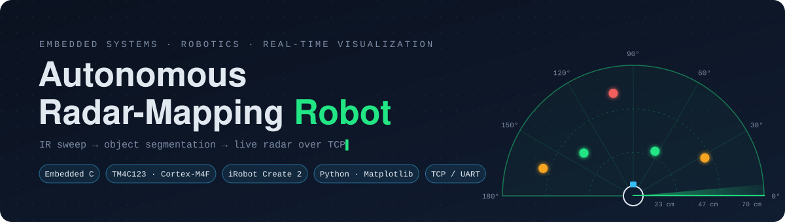
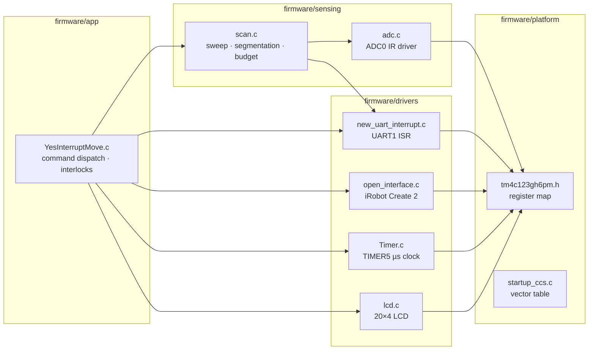
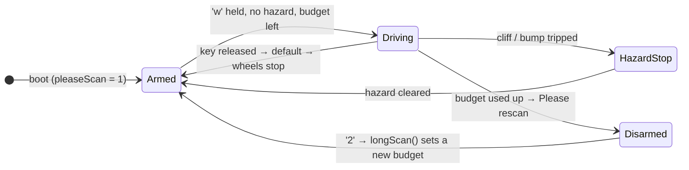
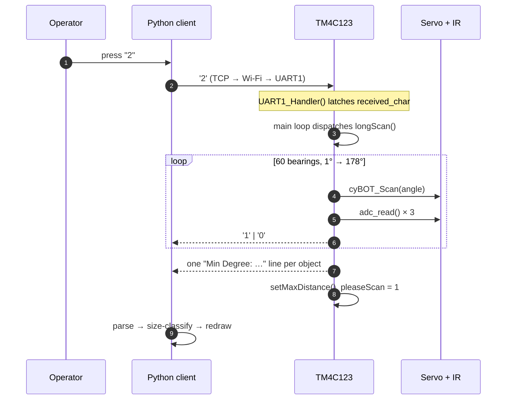

<p align="center">
  
</p>

<p align="center">
  
  
  
  
  
</p>

<p align="center">
  <b>A mobile robot that sweeps an IR sensor across a 180° field of view, turns the raw readings into discrete objects on the microcontroller, enforces hardware safety interlocks while driving, and streams everything to a live Python radar over TCP.</b>
</p>

<p align="center">
  <a href="https://drive.google.com/file/d/17zTY26zI-6VLDzKnHN7GtRfwhL1wV5gx/view?usp=drive_link">▶️ Watch the robot demo</a>
  &nbsp;·&nbsp;
  <a href="https://drive.google.com/file/d/1fBO3oBK7KrYdduAYPxW-klrQkZY_3J-x/view?usp=sharing">📡 View a captured radar scan</a>
</p>

---

## Contents

- [At a glance](#at-a-glance)
- [System architecture](#system-architecture)
- [How a scan becomes a map](#how-a-scan-becomes-a-map)
- [IR sensor model](#ir-sensor-model)
- [Motion control and safety interlocks](#motion-control-and-safety-interlocks)
- [Telemetry protocol](#telemetry-protocol)
- [Visualization clients](#visualization-clients)
- [Engineering highlights](#engineering-highlights)
- [Repository structure](#repository-structure)
- [Build and run](#build-and-run)
- [Controls](#controls)

---

## At a glance

| | |
| --- | --- |
| **MCU** | TI TM4C123GH6PM (ARM Cortex-M4F, 16 MHz), programmed at the register level |
| **Platform** | iRobot Create 2 via the Open Interface serial protocol |
| **Sensing** | Servo-mounted Sharp IR rangefinder · 4 cliff sensors · 2 bump sensors · wheel odometry |
| **Full scan** | 1° → 178° in 3° steps = **60 bearings** |
| **Short scan** | 70° → 110° in 1° steps = **41 bearings** (forward cone) |
| **Noise rejection** | 16× hardware oversampling × 3 software reads = **48 conversions per bearing** |
| **Detection range** | ≤ 70 cm |
| **Link** | UART1 @ 115200 8-N-1 ⇄ Wi-Fi bridge ⇄ TCP `192.168.1.1:288` |
| **Client** | Multithreaded Python: socket RX thread + Matplotlib animation (10 Hz `front_scan`, 2 Hz `top_scan`) |

---

## System architecture

<p align="center">
  
</p>

The firmware is split into four layers, and each layer depends only on the layers below it:



**Concurrency model.** The MCU uses a *foreground/background* design. The UART1 RX interrupt only latches the newest byte into `volatile char received_char`. All decisions happen in the main loop, which re-reads the hazard sensors on every pass. This keeps the ISR to a few cycles and limits shared state to a single byte.

---

## How a scan becomes a map

<p align="center">
  
</p>

1. **Sweep.** `cyBOT_Scan(angle)` points the servo. Three ADC reads are averaged and converted to centimetres.
2. **Hit stream.** Each bearing is classified as a hit (`0 < d ≤ 70 cm`) or a miss and streamed live as `'1'`/`'0'`.
3. **Run-length segmentation.** A single pass groups each contiguous run of hits into one `ObjectData` record. The array grows with `realloc`, so the number of objects has no fixed limit.
4. **Characterization.** When the run ends, the firmware records the object's angular span, midpoint bearing, closest range, and linear width.
5. **Report and plan.** Each object is sent as one telemetry line, and the object distances feed `setMaxDistance()`, the forward-travel budget.

The core of the segmenter, from [`firmware/sensing/scan.c`](firmware/sensing/scan.c):

```c
if(IR_cm > 0 && IR_cm <= 70) {
    uart_sendChar('1'); // Object detected

    if (!inObject) {
        // Rising edge: start a new object record
        currentMinIR = 9999;
        detectedObject = realloc(detectedObject, (objectCount + 1) * sizeof(*detectedObject));
        detectedObject[objectCount].minDegree = degree;
        detectedObject[objectCount].maxDegree = degree;
        inObject = 1;
        objectCount++;
    } else {
        // Still inside the same object: extend its angular span
        detectedObject[objectCount - 1].maxDegree = degree;
    }

    // Track the closest reading across the object
    if (IR_cm < currentMinIR) currentMinIR = IR_cm;
}
```

```c
typedef struct {
    int minDegree;      // First angle at which the object was seen
    int maxDegree;      // Last angle at which the object was seen
    float Irsensor;     // Closest IR distance across the object (cm)
    int midPoint;       // Centre angle of the object
    float objectWidth;  // Estimated linear width (cm)
} ObjectData;
```

**Target recognition.** The firmware compares each object's estimated width against a target signature and reports `Found! Angle: <midpoint>` for a match. The signature is 10–15 cm wide in the short scan and ≥ 9.5 cm in the full scan.

---

## IR sensor model

<p align="center">
  
</p>

The Sharp IR sensor's output is non-linear, so the firmware converts it with an empirical power law fitted from calibration data:

$$
d_{\text{cm}} = 120000 \cdot \bar{x}^{-1.23},\qquad \bar{x} = \tfrac{1}{3}\left(x_1 + x_2 + x_3\right)
$$

Each $x_i$ is itself the average of 16 samples taken by the ADC (`ADC0_SAC_R = 0x04`). Readings of 450 counts or less are rejected as "nothing in range". A second, voltage-based model, `IrToMeters()` ($d = 27.86 / (V - 0.42)$ with $V = 3.3\,x / 4090.2$), is also included.

---

## Motion control and safety interlocks

Forward motion is protected by three independent safeguards:

| Safeguard | Mechanism | Source |
| --- | --- | --- |
| **Dead-man's switch** | `received_char` is cleared every loop pass. With no new key, the `default` case stops the wheels, so motion continues only while the operator holds a key. | `firmware/app/YesInterruptMove.c` |
| **Hazard interlock** | Before each forward step, the firmware checks the cliff and bump sensors and refuses to move if any of them trips. It then reports exactly which sensor tripped. | `boundary_detect()`, `hole_detect()`, `tall_tree_detect()` |
| **Scan-gated distance budget** | Forward travel is capped by the most recent scan. When the odometer reaches the budget, motion is disarmed until a new full scan. | `getMaxDistance()`, `pleaseScan` |

| Hazard | Sensor | Threshold | Report |
| --- | --- | --- | --- |
| Boundary (white tape) | 4 × cliff signal | `≥ 2600` | `Boundary detected: [Left] [Front_Left] …` |
| Hole (black area / drop) | 4 × cliff signal | `≤ 1000` | `Hole detected: …` |
| Tall obstacle | 2 × bumper | pressed | `Rock detected: [Left] [Right]` |



**Closed-loop turning.** Turns do not rely on timing. The robot spins in place and polls the Create's angle odometry every 10 ms, summing the absolute change until it reaches the target (1° for fine turns, 90° for coarse turns). It then reports the new heading and odometry to the LCD and the client.

---

## Telemetry protocol

All traffic is plain ASCII on a single full-duplex link, so it is easy to debug with any serial terminal.

| Direction | Message | When |
| --- | --- | --- |
| Client → Robot | single char: `w a s d 1 2 9 0 q` | every keypress |
| Robot → Client | `1` / `0` stream | each scan bearing |
| Robot → Client | `Min Degree: <a> MaxDegree: <b>, Irsensor: <cm>, Midpoint: <m>, ObjectWidth: <w>` | each detected object |
| Robot → Client | `Found! Angle: <m>` | target signature matched |
| Robot → Client | `Angle: <deg>, Distance Moved: <n>, Max Distance: <n>` | after each turn |
| Robot → Client | `Boundary detected:` / `Hole detected:` / `Rock detected:` + sides | hazard blocked a move |
| Robot → Client | `Please rescan` · `Clear to go straight…` · `Cannot go straight…` | interlock / path verdict |



---

## Visualization clients

Both clients share the same structure. A global keyboard hook forwards commands, a background thread blocks on `sock.recv()` and parses lines into shared lists, and `matplotlib.animation.FuncAnimation` redraws from those lists.

| | [`front_scan.py`](visualization/front_scan.py) | [`top_scan.py`](visualization/top_scan.py) |
| --- | --- | --- |
| View | Dark-mode polar radar + live object table | Polar radar + global field map |
| Refresh | 100 ms | 500 ms |
| Objects | Beam, size-coloured blip, angle / range / width label | Beam, blip, angular-width arc, farthest-object ray |
| Hazards | Parses `CLIFF …` / `BUMP …` events into cliff rays and bump markers | — |
| Pose | — | Dead-reckoned heading and x/y from turn keys and `Distance Moved` telemetry |

**Size classification** (both clients): `small < 5 cm ≤ medium < 15 cm ≤ large`.

**Global mapping** (`top_scan.py`). An object seen at scan bearing $\theta$ and range $d$ while the robot sits at pose $(x_r, y_r, \psi)$ is projected into the world frame:

$$
\begin{aligned}
x_{\text{obj}} &= x_r + d\cos(\psi + \theta - 90^\circ) \\
y_{\text{obj}} &= y_r + d\sin(\psi + \theta - 90^\circ)
\end{aligned}
$$

The 90° offset aligns "straight ahead" on the servo with the robot's heading. A point within 5 cm of an existing landmark is dropped as a duplicate. For display, the map is rotated by $-\psi$ around the robot so it is always drawn centred on the robot and facing forward.

---

## Engineering highlights

**Register-level peripheral bring-up.** The project drivers configure each peripheral directly through its registers. TivaWare driverlib is used only to register the ISR (`IntRegister`, `IntMasterEnable`).

| Peripheral | Key registers | Configuration |
| --- | --- | --- |
| ADC0 · SS3 | `ACTSS` `EMUX` `SSMUX3` `SSCTL3` `SAC` | AIN10 / PB4, software trigger, single-sample end + flag, 16× oversampling |
| UART1 | `IBRD`=8 `FBRD`=44 `LCRH`=0x60 `IM` `CTL`=0x301 | 115200 8-N-1 from 16 MHz, RX interrupt, NVIC IRQ 6 @ priority 1 |
| GPIO B | `AFSEL` `PCTL` `DEN` `AMSEL` | PB0/PB1 muxed to U1RX/U1TX, PB4 analog |
| TIMER5 | `CFG` `TAMR` `TAPR` `TAILR` | 16-bit periodic, 1 µs tick, 65 ms rollover ISR → µs/ms system clock |

The baud divisor is derived by hand: $16\,\text{MHz} / (16 \times 115200) = 8.6806$, so $\text{IBRD} = 8$ and $\text{FBRD} = \text{round}(0.6806 \times 64) = 44$.

**Embedded design practices**

- **ISR / main-loop separation.** The ISR only latches the received byte, and all control logic runs in the foreground loop.
- **`volatile` shared state** between the ISR and the main loop.
- **Fail-safe defaults.** An unknown or missing command stops the robot, and a clear short scan resets the budget to the 70 cm sensor range.
- **Dynamic object storage** with `realloc`, so a scan can return any number of objects.
- **Two-stage noise rejection** (hardware oversampling, then software averaging) before any classification.
- **Self-describing ASCII telemetry**, which works with a TCP socket, a serial terminal, or the Python parser alike.

**Client-side engineering**

- **Producer/consumer threading**: the network thread parses data while the UI thread renders it.
- **Robust parsing**: each line is parsed in its own `try/except`, so one corrupt packet never kills the stream.
- **Coordinate transforms** for robot-to-world projection and world-to-robot display, plus spatial de-duplication.

---

## Repository structure

```text
Autonomous-Navigation-Robot/
├── firmware/
│   ├── app/
│   │   └── YesInterruptMove.c        # main(): command dispatch, hazard interlocks, closed-loop turns
│   ├── sensing/
│   │   ├── scan.c                    # IR sweep, run-length segmentation, distance budget
│   │   ├── cyBot_Scan.h              # scan API + libcybotScan (servo/PING/IR) interface
│   │   └── adc.c / adc.h             # ADC0 SS3 driver for the IR sensor (PB4)
│   ├── drivers/
│   │   ├── new_uart_interrupt.c / .h # interrupt-driven UART1 (telemetry + commands)
│   │   ├── open_interface.c / .h     # iRobot Create 2 Open Interface
│   │   ├── Timer.c / Timer.h         # TIMER5 µs/ms timebase and delays
│   │   └── lcd.c / lcd.h             # 20×4 character LCD
│   └── platform/
│       ├── tm4c123gh6pm.h            # TM4C123GH6PM register definitions (TI)
│       └── tm4c123gh6pm_startup_ccs.c  # vector table + reset handler (TI)
├── visualization/
│   ├── front_scan.py                 # live polar radar + object table
│   └── top_scan.py                   # radar + dead-reckoned global map
├── docs/
│   └── assets/                       # animated SVG figures used in this README
└── ide/
    └── ccs/                          # Code Composer Studio generated build files + target config
```

---

## Build and run

### Firmware (Code Composer Studio)

1. Create a CCS project for **Tiva TM4C123GH6PM** and add the `firmware/` folder.
2. Add these include paths: `firmware/drivers`, `firmware/sensing`, `firmware/platform`, and your TivaWare root (for `<inc/tm4c123gh6pm.h>` and `driverlib/interrupt.h`).
3. Link `driverlib.lib` (TivaWare) and the course-provided `libcybotScan.lib`, which supplies the servo/PING/IR scan routines.
4. Build, flash, and power on the robot. Its Wi-Fi bridge serves `192.168.1.1:288`.

> `ide/ccs/` keeps the original CCS-generated makefiles and `.ccxml` target configuration for reference. CCS regenerates these files for your own workspace.

### Visualization

```bash
pip install numpy matplotlib keyboard
```

Connect to the robot's Wi-Fi, then run:

```bash
python visualization/front_scan.py   # radar + object table
# or
python visualization/top_scan.py     # radar + global map
```

If your robot uses a different address, edit `HOST` / `PORT` at the top of the script. On macOS and Linux the `keyboard` package needs elevated privileges to install a global key hook.

---

## Controls

| Key | Action |
| --- | --- |
| `w` | Drive forward (hazard-checked, budget-limited); hold to keep moving |
| `s` | Reverse slowly |
| `a` / `d` | Rotate left / right 1° (closed-loop) |
| `9` / `0` | Rotate left / right 90° (closed-loop) |
| `1` | Short scan: 70°–110°, 1° resolution |
| `2` | Full scan: 180°, 3° resolution; re-arms forward motion |
| `q` | Play a tune on the Create's speaker |
| `m` | *(client)* clear the radar |
| `n` | *(top_scan)* clear the global map |
| `esc` | *(client)* disconnect |

---

<sub>Platform drivers `Timer.c`, `lcd.c`, and `open_interface.c`, and the `libcybotScan` interface, are course-provided (authors credited in each file header). The TM4C123 register header and startup code are © Texas Instruments.</sub>
